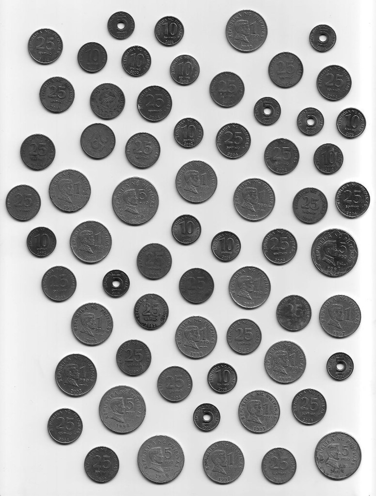
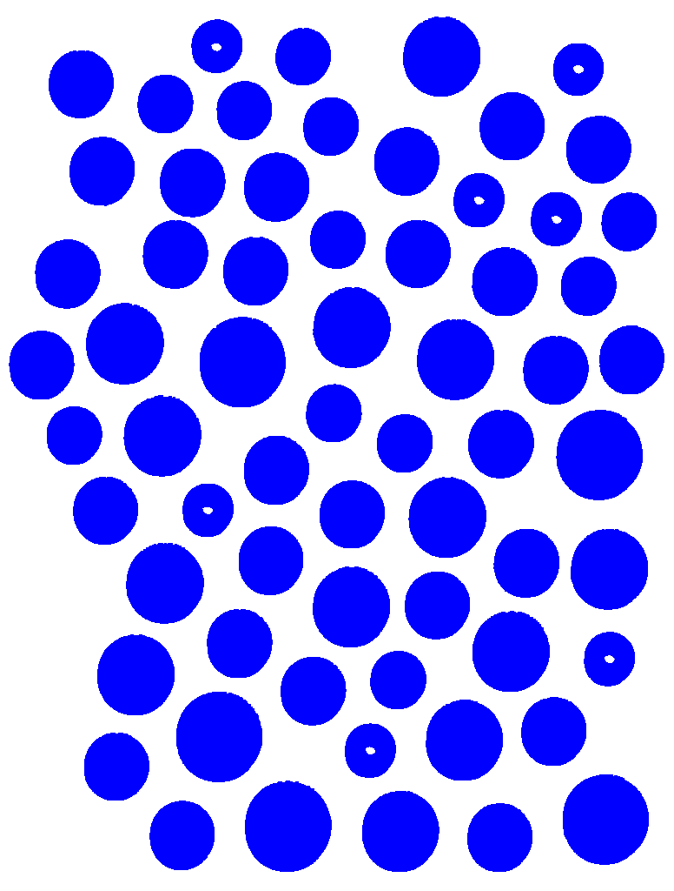

# Coin Counter & Classifier

This project processes an image of scattered coins, flattens the colors to remove noise, counts the coins, and groups them by their 5 denominations.

### Expected Output (Manual Counting)
- **Total Coins:** 64
- **5 Cent:** 7 coins
- **10 Cent:** 11 coins
- **25 Cent:** 28 coins
- **1 Peso:** 13 coins
- **5 Peso:** 5 coins

### Program Output
```text
Loading image...
Background base color: C(255, 255, 255)
Finding islands using BFS...

Found 64 total coins.
Grouped into 5 coin denominations:
- 5 Cent   (~2832 pixels):  7 coins  (Unit: ₱0.05 | Subtotal: ₱0.35)
- 10 Cent  (~3438 pixels): 11 coins  (Unit: ₱0.10 | Subtotal: ₱1.10)
- 25 Cent  (~4722 pixels): 28 coins  (Unit: ₱0.25 | Subtotal: ₱7.00)
- 1 Peso   (~6572 pixels): 13 coins  (Unit: ₱1.00 | Subtotal: ₱13.00)
- 5 Peso   (~8217 pixels):  5 coins  (Unit: ₱5.00 | Subtotal: ₱25.00)

Total Coins:  64
Total Amount: ₱46.45
```

## How to Run

The program has already been compiled into `.exe` files in the [executables folder](executables).

### Running the Windows Forms UI (IslandCounter)
1. Open the [executables folder](executables) and double-click `IslandCounter.exe` (or run `dotnet run --project IslandCounter`).
2. The graphical UI opens and automatically loads and processes the coins:
   - **Automatic Detection:** On launch, the blue flattened coin image is loaded and analyzed automatically.
   - **BFS Detection & Classification:** You can click **🔍 Analyze & Count Coins (BFS)** to re-run detection after adjusting the minimum area or denomination count.
   - **Interactive Visualizer:** Hover over or click any coin in the image preview to view its exact area, denomination, and coordinates.
   - **Display Options:** Toggle bounding circles, centroid dots, denomination badges, or coin numbers.

*(Note: If you prefer command-line output, you can still run `IslandCounter.exe --cli` from a terminal).*

### Running ColorReducer
1. Open the [executables folder](executables) and double-click `ColorReducer.exe` (or run `dotnet run --project ColorReducer`).
2. This reads `coins.jpeg` and outputs a clean `coins_flattened.png` image with **blue coins** on a white background.

## How it Works

The process is split into two main steps:

### 1. Color Reducer
First, I needed to clean up the image so it's easier to process. The program applies a thresholding algorithm to convert the image into two distinct colors (white background and blue coins).

The `ColorReducer` script goes through every single pixel in the original image, calculates its luminance (brightness), and changes it to pure white (`#FFFFFF`) if it's bright enough (background), or pure blue (`#0000FF`) if it's darker (coins). To fix any tiny "noise" holes inside the coins caused by reflections, each background pixel touching a blue coin pixel is turned into a blue coin pixel. It then saves the result as a PNG file so we don't get any new compression artifacts.

## Before and After Flattening Process

| Original (`coins.jpeg`) | Flattened (`coins_flattened.png`) |
| :---: | :---: |
|  |  |

### 2. Island Counter (GUI & BFS Engine)
Next, the program scans the clean image using a **Breadth-First Search** (BFS) algorithm to count the "islands" (the coins).
- It skips any islands smaller than 1000 pixels since those are just dust or noise.
- Once it calculates the pixel areas of all the valid coins, it sorts them by size.
- Since we know there are exactly 5 coin denominations (5 Cent, 10 Cent, 25 Cent, 1 Peso, 5 Peso), the algorithm calculates the differences in size between the sorted coins. It automatically finds the 4 largest size gaps (natural breaks) and uses those as the split points to perfectly group the coins.
- In the Windows Forms UI (`Form1.cs`), each coin is mapped to its bounding geometry and labeled with its denomination badge and color coding.

## Limitations

- **Image Quality & Clarity:** The program is limited to clear images of coins. Heavy shadows or overlapping coins could cause them to blend together.
- **Size-Based Classification:** Because the program groups the coins purely based on their surface area, coins from different denominations with a size difference that is small enough will confuse the program.